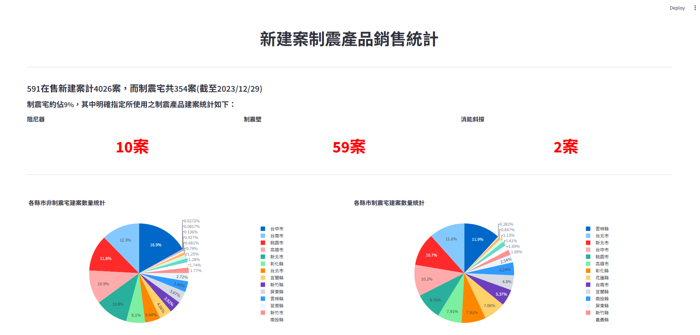
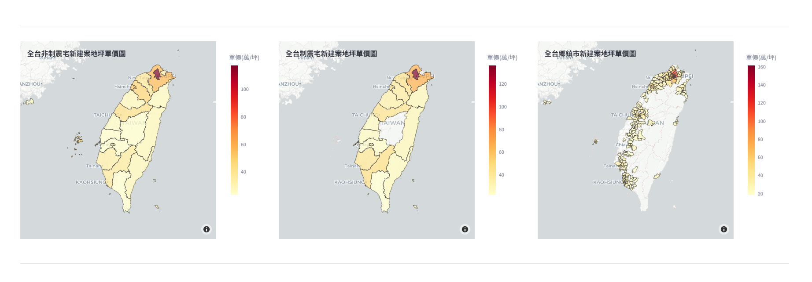
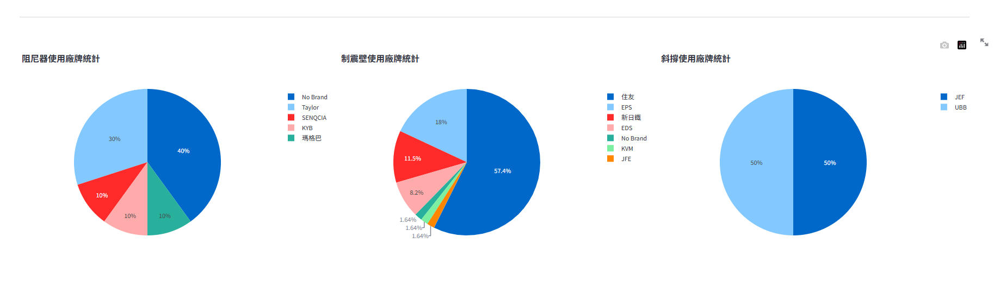

# 新建案制震產品銷售統計 Dashboard


---

## 專案簡介

搭配 [591 新建案爬蟲](https://github.com/Ericlinyuting/Web_Crawler_591) 所產出的資料，以 Streamlit 製作的台灣新建案制震產品銷售統計 Dashboard。
可視化呈現全台在售建案中，**阻尼器、制震壁、消能斜撐**三類制震系統的使用分布、廠牌佔比，以及各縣市的房價地圖。

---

## 畫面預覽

### KPI 指標 ＆ 縣市分布圓餅圖


### 全台新建案地坪單價地圖


### 制震系統廠牌佔比


---

## 功能特色

- **KPI 摘要**：快速呈現目前在售的制震宅總數（阻尼器、制震壁、消能斜撐各幾案）
- **縣市分布圓餅圖**：比較制震宅與非制震宅在各縣市的分布比例
- **三張互動式 Choropleth 地圖**：
  - 全台非制震宅地坪單價
  - 全台制震宅地坪單價
  - 全台鄉鎮市地坪單價（細至區級）
- **廠牌分析圓餅圖**：阻尼器、制震壁、消能斜撐各類品牌市佔率

---

## 資料來源

由 [591 新建案爬蟲](https://github.com/Ericlinyuting/Web_Crawler_591) 爬取，輸出為 `asset/ALL_data.xlsx`。
地理資料：內政部 GeoJSON（縣市界線、鄉鎮市區界線）。

---

## 技術棧

| 套件 | 用途 |
|------|------|
| [Streamlit](https://streamlit.io) | 前端 UI 框架 |
| [Plotly](https://plotly.com) | 互動式圖表與 Choropleth 地圖 |
| [Pandas](https://pandas.pydata.org) | 資料處理 |
| [Pillow](https://python-pillow.org) | 圖片處理 |

---

## 本地執行

### Docker（建議）

```bash
docker compose up --build
```

啟動後開啟瀏覽器訪問：**http://localhost:8501**

停止服務：

```bash
docker compose down
```

### 直接執行

```bash
# 1. 安裝相依套件
pip install -r requirements.txt

# 2. 啟動應用
streamlit run 新建案制震產品統計.py
```

### Conda 環境（選用）

```bash
conda env create -f environment.yml
conda activate <env_name>
streamlit run 新建案制震產品統計.py
```

> Python 3.11.5 開發，建議使用相同版本。
